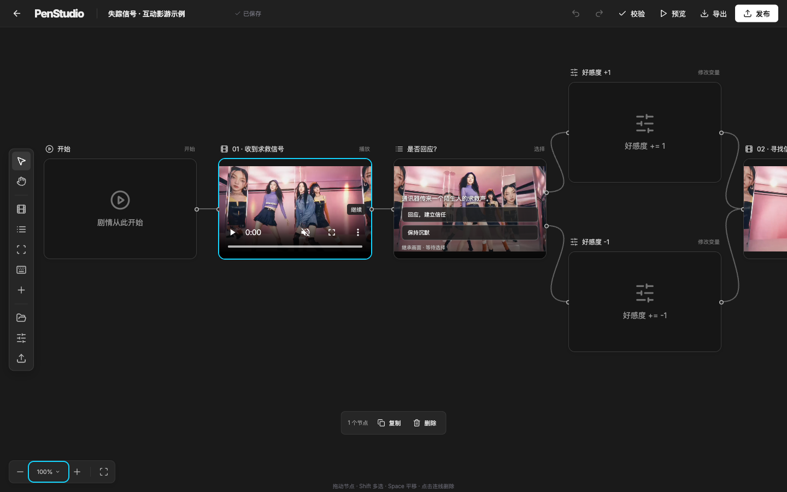
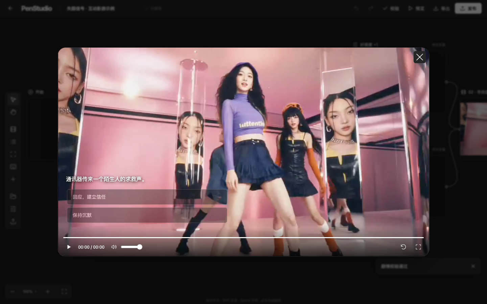
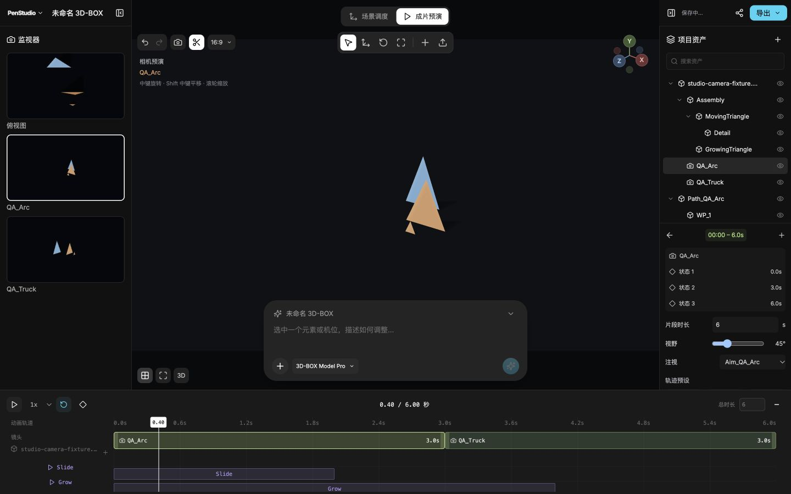
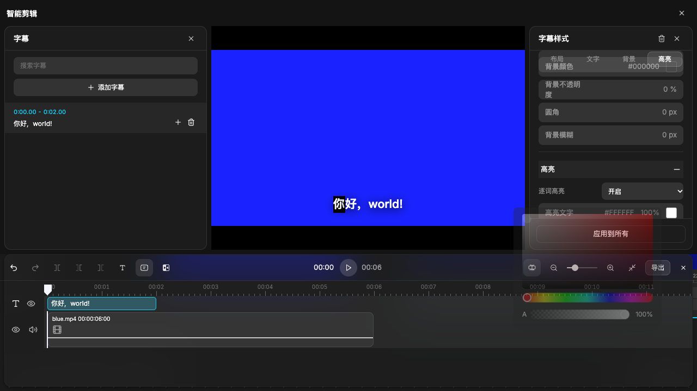
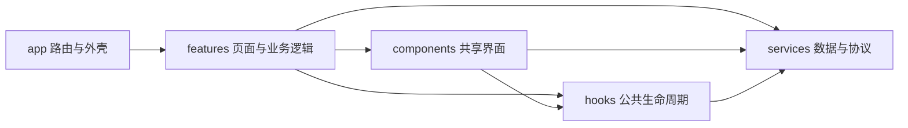

# OpenLibTV

> 一个以 LibTV 为视觉与交互参照的 React + Vite 创作工作台。它把公开样本、Canvas 节点编辑、3D Studio、字幕剪辑、Skill、学院和互动影游放在同一套可运行的前端里。

[在线体验](https://penstudio-libtv.vercel.app/) · [互动影游编辑器](https://penstudio-libtv.vercel.app/interactive-film) · [匿名试玩示例](https://penstudio-libtv.vercel.app/interactive-film/play/2ed10a7c-3009-41a9-aeae-0cf2a1610de3) · [GitHub](https://github.com/yizhiqianbi/OpenLibTV)

OpenLibTV 当前按“可操作的代表性真实样本”验收，不把无限采集内容当作完成度指标。默认打开即进入本地工作区，不需要登录；项目、画布、资产和 Skill 可以直接体验。接入自己的运营后端后，内容、项目、资产、任务、会话和 Agent 可以通过统一代理切换到服务端。

## 先看效果

<table>
  <tr>
    <td width="50%"><a href="https://penstudio-libtv.vercel.app/interactive-film"></a></td>
    <td width="50%"><a href="https://penstudio-libtv.vercel.app/interactive-film/play/2ed10a7c-3009-41a9-aeae-0cf2a1610de3"></a></td>
  </tr>
  <tr>
    <td align="center">互动影游：节点编排、片段切点、分支与发布</td>
    <td align="center">互动影游：选择、热点和 QTE 叠加在视频画面中</td>
  </tr>
  <tr>
    <td><a href="https://penstudio-libtv.vercel.app/animation-preview?newProject=true"></a></td>
    <td><a href="https://penstudio-libtv.vercel.app/canvas"></a></td>
  </tr>
  <tr>
    <td align="center">3D Studio：GLB 层级、机位、动画和时间轴</td>
    <td align="center">Canvas 剪辑器：字幕轨道、样式、逐字高亮和导出入口</td>
  </tr>
</table>

## 你可以直接体验什么

| 入口                                                                                                                      | 已实现的可体验内容                                                                          | 当前边界                                                |
| ------------------------------------------------------------------------------------------------------------------------- | ------------------------------------------------------------------------------------------- | ------------------------------------------------------- |
| [`/canvas`](https://penstudio-libtv.vercel.app/canvas)                                                                    | 节点画布、Agent 输入、引用与 target 模式、素材库、分镜、连线、历史、剪辑器、字幕和本地保存  | 真实模型生成、上传审核、多人协作和云端写入等待运营服务  |
| [`/animation-preview?newProject=true`](https://penstudio-libtv.vercel.app/animation-preview?newProject=true)              | GLB 导入与恢复、层级副本、材质/变换、动画、相机轨道、时间轴、浮动机位预览和浏览器 WebM 导出 | 服务端渲染、完整高级 3D 工具、触摸/Safari               |
| [`/interactive-film`](https://penstudio-libtv.vercel.app/interactive-film)                                                | 影游节点、视频/图片、热点、选择分支、变量、QTE、预览、导出、发布和匿名播放                  | 发布依赖 Blob 与服务端环境变量；不替代通用生成/支付服务 |
| [`/skill`](https://penstudio-libtv.vercel.app/skill) / [`/skill/create`](https://penstudio-libtv.vercel.app/skill/create) | Skill 浏览、创建、分享、Mine、本地草稿、附件和公共选择器                                    | 真实审核、团队权限、公开发布和账号权益                  |
| [`/academy`](https://penstudio-libtv.vercel.app/academy)                                                                  | 学院首页、图文/视频/课程/跟练入口、播放器、章节目录和本地状态                               | 课程授权、订单、进度写服务和完整跟练闭环                |
| [`/xumeng`](https://penstudio-libtv.vercel.app/xumeng)                                                                    | 角色卡、世界书、状态、记忆、SillyTavern v2 导入/导出和流式对话界面                          | 需要配置 `XUMENG_BACKEND_URL`；未配置时不伪造模型回复   |
| `/api/backend/*` / `/api/xumeng/*`                                                                                        | 白名单、HTTPS、请求体限制、Cookie 过滤、CAS、SSE/NDJSON 转发                                | 上游认证、模型、队列、持久化和所有权由运营后端负责      |
| `npm run tool:mcp`                                                                                                        | 只读读取路由、公开快照和内容搜索的本地 MCP 工具桥                                           | 不读取账号、浏览器状态、生成、支付或生产写服务          |

其余已注册入口包括 `/show`、`/detail/:uuid`、`/profile`、`/project`、`/assets`、`/activity`、`/feature-updates`、`/plugin`、`/blender`、`/academy/course/:id`、`/academy/practice/:id`、`/academy/product/:id`、`/academy/article/:id`、`/academy/tutorial/:id`、`/canvas/share`、`/canvas/chat-share`、`/canvas/import/blender`、`/skill/share`、`/mcp/authorize` 和 `/seedance-verify`。直接访问、刷新、query/hash 变化和未知路由都有独立的路由处理。

## 完整度怎么理解

OpenLibTV 的完成度按桌面 Chromium、本地前端状态和已核实的服务边界评估：

- **已落地并可回归**：路由与外壳、作品/Skill/学院等公开页面、Canvas 节点与编辑事务、字幕与剪辑器、3D Studio、互动影游编辑器与播放器、本地持久化、通用代理协议、叙梦可选适配、MCP 工具桥。
- **本地可操作但需要服务才能闭环**：项目/资产/Skill/Canvas 保存、上传、生成任务、课程进度、评论、发布和 Agent 运行。前端会保留草稿、错误态和重试入口，不把本地 actor 当作账号。
- **明确保留的服务边界**：真实认证、模型生成、支付、审核、多人协作、跨设备同步、云端对象存储、服务端渲染，以及触摸/Safari 兼容。

| 范围                             | 状态                          | 证据入口                                                                                       |
| -------------------------------- | ----------------------------- | ---------------------------------------------------------------------------------------------- |
| 页面、路由、状态和主要交互       | ✅ 可运行                     | [`src/app/router`](./src/app/router)、[`research/coverage.md`](./research/coverage.md)         |
| Canvas / 字幕 / 3D Studio        | ✅ 已接入代表性流程           | [`src/features/canvas`](./src/features/canvas)、[`src/features/studio`](./src/features/studio) |
| 互动影游 v1                      | ✅ 已部署并可匿名试玩         | [`research/interactive-film-audit.md`](./research/interactive-film-audit.md)                   |
| 通用 LibTV 后端与叙梦代理        | ✅ 前端协议和 Function 已接入 | [`src/services/agent-api.js`](./src/services/agent-api.js)、[`api/backend`](./api/backend)     |
| 认证、生成、支付、协作和运营写入 | ⏳ 等待上游服务               | [`AGENTS.md`](./AGENTS.md) 的服务边界说明                                                      |

## 当前验证与线上版本

当前工作区的完整检查记录为 **501 个测试文件、6753 项测试**，并通过格式检查、零警告 lint、核心 TypeScript strict 和生产构建。最近生产版本来自当前工作区 HEAD：

- [线上首页](https://penstudio-libtv.vercel.app/)
- [不可变部署地址](https://penstudio-libtv-epzriz3zz-bins-projects-795df2ea.vercel.app)
- 部署产物：2,582 个文件，94,396,284 字节，低于 95 MB 上限
- 已复验首页、Canvas、Skill、资产、3D Studio、互动影游、公开快照和四个影游 Function 路由
- 生产环境暂未配置 `LIBTV_BACKEND_URL` 或 `XUMENG_BACKEND_URL`，因此代理协议已上线但真实运营上游仍需单独接入

## 快速开始

```sh
npm ci
npm run dev
```

打开 `http://localhost:5173`。想验证 Vercel Functions、互动影游发布和代理路由时使用：

```sh
npm run dev:server
```

常用检查：

```sh
npm run check       # 格式、lint、核心类型、测试、生产构建
npm run test:mcp    # MCP 初始化、工具发现、调用和路径安全
npm run build       # 生产前端构建
```

后面的章节保留工程目录、服务契约、持久化、扩展约定和审计记录，方便继续开发或接入自己的后端。

## 本地开发

开发与 CI 统一使用 `.nvmrc` 中的 Node.js 24。`package.json.engines` 兼容 Node 22.13 或 24 及以上；22.12 不满足当前 jsdom 依赖要求。

```sh
npm ci
npm run dev
```

开发地址为 `http://localhost:5173`。部署时仅非 `/api` 的前端路由回退到 `index.html`；保留 Vercel Functions/API，并允许 `/data/`、`/assets/` 静态资源正常返回及缺失资源的真实 404。

Vercel 的当前部署使用独立的代表性样本包，保留全部页面入口和编译模块。本地 `public/` 不被裁剪；`npm run vercel:prepare` 先生成完整 Vercel Build Output，再仅替换静态样本并保留 Functions/config/routes，同时在 `artifacts/vercel-package-report.json` 记录保留样本、文件大小和范围。样本包超过 95 MB 时停止，不能通过删除正在使用的素材绕过检查。此包面向当前免费套餐，部署使用 `vercel deploy --prebuilt --prod`。常规 `npm run build` 仍包含本地全部公开样本。

部署前确认 `vercel project inspect --non-interactive` 报告目标项目正确，再运行 `npm run check` 和样本打包。影游发布使用独立 Functions 与公共 Blob；LibTV 通用 API 通过下方的服务端代理接入。未配置运营后端时，创作项目、资产、Skill 与画布数据仍保存在当前站点的浏览器本地。部署域名与 `localhost` 的浏览器存储独立，不会自动同步本地项目。

## LibTV 通用后端与 Agent

通用客户端位于 `src/services/api-client.ts`，覆盖公开内容、项目/目录、资产与上传、Skill、Canvas、生成任务、订单、社交、会话和统一 Agent。Vercel 的 `/api/backend/*` 只允许这些明确路径，使用 `LIBTV_BACKEND_URL` 转发到运营服务器；它不会把任意路径、浏览器凭据或本地 actor 透传给上游。变更请求要求同源，Canvas 保存可通过 `If-Match` 做版本控制，流式 Agent 与任务保留 SSE/NDJSON 响应。

复制 `.env.example` 后设置 `VITE_API_BASE_URL=/api/backend` 和服务端变量 `LIBTV_BACKEND_URL=https://<operator-api>`。上游负责认证/访客会话、所有权、CAS、项目与资产持久化、模型调用、任务队列和 Agent 结果；代理未配置或上游失败会返回结构化错误，前端保留草稿，不把失败显示成成功。现有本地仓库仍是未接入运营服务时的可逆 fallback。

## 叙梦 Agent 可选适配

`/xumeng` 提供独立的叙梦 Agent 工作台：角色卡编辑、SillyTavern `chara_card_v2` 导入/导出、世界书、状态、记忆和流式对话都通过 `/api/xumeng/*` 访问。浏览器只持有结构化请求和响应，外部模型服务地址与凭据留在 Vercel Function 的服务端环境变量中；页面不会用本地假回复替代服务结果。

在通用 LibTV 后端之外，需要叙梦时再设置 `XUMENG_BACKEND_URL=https://<operator-api>`。默认 `XUMENG_BACKEND_PROTOCOL=generic`，要求上游提供 `/health`、`/characters`、`/sessions`、`/chat`、`/memory` 及角色卡导入导出接口；连接 IntVideoGameEditor 的兼容服务时使用 `XUMENG_BACKEND_PROTOCOL=dzmm`。未配置上游时接口返回明确的 503 配置错误，页面保持错误态，不伪造保存、生成或持久化成功。

上游服务负责认证、模型调用、会话持久化、CAS/版本控制、状态补丁和记忆写入；本仓库的 Function 只做 HTTPS 白名单代理、请求大小/来源校验、协议适配和流式转发。当前前端在当前页面内携带完整消息历史，刷新后的长期会话依赖上游会话接口，不能把浏览器临时状态当作账号数据。

```sh
npm run check         # 格式、lint、核心类型、回归测试、生产构建
npm run test:watch    # 本地迭代
npm run format       # 统一格式
npm run build
npm run preview
```

## Code Agent 工具桥

仓库提供一个无需额外依赖的本地 MCP stdio 工具桥，供 Code Agent 读取当前 checkout 的公开样本、路由和能力边界。它是只读工具：不读取浏览器存储，不发送账号凭据，不调用生产 API，也不假装完成生成、支付或 MCP 授权。

```sh
npm run tool:mcp
```

按插件方式注册时，Codex / 其他 MCP 客户端会读取根目录的 `.mcp.json` 自动启动它；手动配置时使用命令 `node scripts/penstudio-mcp-server.mjs`。当前工具包括 `get_capabilities`、`list_routes`、`resolve_route`、`list_content`、`get_content` 和 `search_content`。读取大数据集时请用 `jsonPointer` 与 `limit` 限定返回范围。`npm run test:mcp` 会验证 MCP 初始化、工具发现、工具调用和路径安全。

仓库同时包含可打包的 `.codex-plugin/plugin.json`、`.mcp.json` 和 `skills/penstudio/SKILL.md`。将仓库作为本地插件注册时，Code Agent 会在本机启动这个只读 server；它不会自动获得账号、浏览器本地项目或生产生成权限。

`.github/workflows/check.yml` 在 push / pull_request 执行 `npm ci` 和同一套 `npm run check`，只授予 contents:read，官方 actions 固定 commit，Node 版本从 `.nvmrc` 读取。配置依据 [checkout](https://github.com/actions/checkout) 与 [setup-node](https://github.com/actions/setup-node) 官方文档；GitHub 仓库为 [yizhiqianbi/OpenLibTV](https://github.com/yizhiqianbi/OpenLibTV)，CI 是否已在远端执行以 Actions 页面为准。

## 目录与职责

```text
src/
  app/                 路由、站点外壳、全局 UI 状态与弹窗协调
    router/            路由匹配、地址订阅、lazy 页面入口
    layout/            侧栏、顶栏、促销横幅与移动端外壳
    overlays/          全局会员/客服/通知的显示逻辑
  features/            按业务域组织页面、组件、hooks、纯模型和样式
    home/ gallery/ skills/ projects/ assets/ profiles/
    academy/           学院页面与 player/ 实际播放器模块
    activities/ plugin/ blender/ system/
    canvas/ studio/    编辑器状态、持久化、键盘/视口和视图组件
    editor/            两类编辑器共用的历史与模型工具
    shared/secondary/  次级内容状态、正文、旧样式与兼容出口
  services/            内容仓库、请求缓存、素材映射、浏览器存储、API 契约
  hooks/               内容、本地状态和公共弹窗生命周期
  components/          跨业务域 UI（含 Agent 输入、引用预览及 Skill 选择界面）
  styles/              主题、基础 UI、响应式和既有覆盖规则
  pages/               旧路径的兼容出口，新代码直接引用 features
  test/                浏览器单元测试环境
public/data/           可替换的公开内容样本与画布快照
public/assets/         当前样本使用的素材
research/             原站证据、覆盖清单及历史审查
scripts/              可恢复素材归档与 ESLint 工程依赖规则
```

`App.jsx` 只协调路由、外壳和全局弹窗。各页面按路由 `React.lazy` 加载；重型 3D、画布、Markdown 和 HLS 不进入基础外壳的启动逻辑。编辑器的文档加载、自动保存、撤销、键盘事件和 WebGL 生命周期分别由 hooks 或模型模块负责，页面组件负责协调视图。

## 依赖方向



`npm run lint` 内置 `architecture/import-boundaries`，约束共享层不能反向引用业务页面，services 不能依赖 React UI，业务域不能引用 app/旧 pages 或其他域的私有模型、组件和 hooks。静态 import、re-export、lazy import 与无插值模板路径都检查；旧兼容出口仅允许明确的转出。共享层也不能通过 `data.js` 聚合入口绕过约束。

`features/*/domain/` 和约定的 `model` / `*-model` / `schema` / `geometry` 模块还受域内方向约束：不能依赖 views、hooks、UI 库或 CSS。React 生命周期和用户动作放在 controller，规则接收显式数据或服务。此约束允许 Three 纯数学与明确文档 API，不将所有 feature 内部路径视为可互相引用。

跨域嵌入使用明确页面入口；资产导入和 Studio 转画布使用 `features/canvas/document-api.js`，它只提供文档构造/持久化，不加载画布 UI。确有新的跨域协作需求时，先提取公共协议或小型入口，再更新规则及回归用例，避免把整个目录加入白名单。当前规则检查代码导入边界，不代替运行时数据校验，也不重排既有 CSS 级联。

Skill 页的目录/Mine 由页面协调；`SkillComposer.jsx` 渲染输入，`useSkillComposer.js` 持有编辑器身份、query 交接、上传与弹出状态；跨页面可用的选择器和详情位于 `components/skills/`。资产选择器 UI 位于 `components/agent/AgentAssetPicker.jsx`，分页状态与记录规则位于 `hooks/useAssetPickerPages.ts` / `services/asset-picker/model.ts`，旧 `features/skills/assets/` 只兼容导出；可注入只读 `assetSource.list(filters, { signal })`，采用 20 项分页、300ms 搜索和 opaque cursor；取消、迟到响应、追加失败和重试不丢已选记录。

创建页分别按需加载 TipTap Markdown 和 CodeMirror 6，纯 diff 算法、扩展、文件树与视图分开维护。播放器分为编排、控制栏/抽屉、媒体/视口/浮窗/冻结帧 hooks 和纯模型；真实课程授权及运营写服务继续由 adapter 边界处理。

## 增加页面

1. 在 `src/features/<domain>/` 新建页面，提供 default export。通用属性为 `path`、`search`、`navigate`、`login`、`user`、`toast`。
2. 在 `src/app/router/routes.ts` 注册路由匹配、布局和标题；在 `RouteOutlet.jsx` 注册直接指向该页面的 lazy import。
3. 业务组件、hooks、过滤和编辑算法留在对应域，跨域基础 UI 才进入 `components/`。
4. 为新增路由匹配和有状态关键流程补充回归检查。直接访问、刷新、前进/后退和 query 变化均需核对。

路由地址通过 `useRouter` 统一订阅；业务导航使用 `navigate`，避免自行调用 `history.pushState` 而不通知 React。详情和项目的 query 变化会重新挂载页面，避免沿用上一地址的局部状态。Skill 列表仅按 pathname 挂载，分享参数消费和清理通过 `search` 更新，保留正在编辑的文字、引用和焦点；hash 变化不重挂载。`/en` 和无参数 `/forbidden` 的兼容重定向集中管理，未知路由使用 404 页面。

## 内容与运营服务器

页面优先使用 `useContent(name, fallback)`：返回 `data`、`loading`、`error`、`reload`。非 React 流程使用 `loadContent(name)`。默认读取 `/data/<name>.json`；内容 key 可以是 `gallery-details/<uuid>`，并在仓库层检查路径是否合法。缓存提供请求去重、五分钟 TTL、显式失效和失败重试；无效或失败请求不会永久占住缓存。

```jsx
const { data, loading, error, reload } = useContent('gallery', { items: [] });
```

旧 `data.js` / `useData` 保留兼容出口，新的异步页面应显式显示 loading、error 和 retry。素材使用 `asset(url)`，由 `services/assets.ts` 映射本地样本；映射失败时保留原 URL，映射读取可重试。

复制 `.env.example` 为 `.env.local`，设置 `VITE_API_BASE_URL=/api/backend` 后，内容仓库会读取运营服务器的 `GET /content/<name>`，项目、资产、Skill、Canvas、任务和 Agent 通过同一 API 客户端使用对应资源路径。返回可以是原有快照对象或 `{ "data": <快照对象> }`；内容字段目前保留源样本形状，服务器应按现有内容 key 提供兼容返回。未设置该变量时页面继续使用本地演示，不能把本地 actor 当作服务器认证。

`services/api-client.ts` 是类型化请求入口，处理 JSON/FormData、HTTP 错误、取消和会话过期通知；`services/contracts.ts` 定义分页、项目、目录、资产、Skill、画布 revision、生成任务和订单等运营接口形状。接入下一类服务时，应在所属业务域新增 repository/adapter，将本地模型映射为这些契约，再切换页面调用。核心服务已使用 strict TypeScript；现有 JSX 页面逐步迁移，尚未做到全项目类型覆盖或所有响应的运行时 schema 校验。

禁止把凭据放在 `VITE_*` 变量中：它们会进入浏览器产物。当前没有启用真实认证请求。

## 本地持久化

统一使用 `useLocalState` / `useStoredState` 或 `services/storage.ts`，不要新增散落的 `localStorage` 读写。现有 key 和 JSON 格式保留；原本字符串标记使用 `readStoredString` / `writeStoredString`，session 标记传 `{ scope: 'session' }`。同页面与跨标签页订阅统一处理，写入失败不得清空最后有效数据。

需要结构升级时使用 `version` / `migrate`；版本元数据独立保存，避免破坏旧 JSON。编辑器持久化留在域内 `persistence.js`，自动保存/加载 hook 不负责业务渲染。公共弹窗、编辑器弹窗和嵌入画布共用 `useDialogBehavior` / `services/dialog-stack.ts`，负责顶部弹窗 Escape、Tab 焦点循环、回焦点、背景隔离与叠加滚动锁。

资产库的规范存储为 `libtv-asset-library`，版本为 1，资产、文件夹和标签保存在同一文档中一次提交。`services/asset-library/model.ts` 提供归一化、文件夹层级、筛选、选择、移动、删除和标签等纯模型；`hooks/useAssetLibrary.ts` 负责版本迁移、读写错误和同标签页/跨标签页订阅。旧 `libtv-assets` 仅作为兼容来源，不删除或覆盖；已有有效规范文档时优先使用它，无规范文档时旧数据读取/格式错误必须显示并阻止误写空库。配额失败保留最后有效数据和当前表单、已读取文件；部分上传成功后保留失败队列供重试，不重复保存成功项。资产页由 controller/upload hooks 协调独立 views，外部更新后的选择和上传目标按当前库重新验证。

弹窗 hook 在 React `autoFocus` 提交前记录打开控件，关闭后恢复该控件；已有预览下打开自动聚焦的编辑弹窗仍保留输入框的初始焦点。嵌套关闭和 StrictMode effect replay 共用同一 stack，不能为某个业务弹窗另建滚动锁或背景隔离。

跨页面创作引用协议放在 `services/agent-handoff.js`。session 暂存包含模型、Skill 和媒体来源，Canvas 先保存到文档再消费；复制、快照分享和导出保留结构化草稿与有序消息 parts。自动保存仅处理已加载的当前文档，离开或 pagehide 时刷写最后一次待保存内容。

3D 文档保存 GLB 内嵌来源并通过 GLTFLoader 恢复实际对象，导出等待资源加载结束；视口负责释放几何、材质和纹理。Meshopt / Draco 解码按需使用 Three 官方资产，导入 clips 由实际 mixer 播放、seek、保存并导出。相机路径和镜头分域管理；外部纹理 / KTX2 与视频导出仍未完成。浏览器本地配额失败有提示，大文件与跨设备分享应接运营对象存储。

学院评论分为纯模型、本地 source repository、异步状态 hook 和编辑/列表/弹窗 views。共享组件具备可配置排序、点赞/踩、作者置顶、删除、举报和回复分页；实际大师课按原源码固定 **200 字、最新顺序**，不显示排序、点踩或置顶按钮，不能把共享组件默认 500 字和能力分支套到该页面。评论操作只在本机持久化；没有公开正文样本时明确空态，测试夹具不作为原站评论展示，真实写入和审核服务尚未接入。

Blender 展示页在 idle 后动态加载独立 Three runtime，hook 管理初始化取消、RAF、尺寸/可见性/context 监听和失败回退；runtime 管理视频纹理、地面贴图、几何、材质及反射/模糊 render targets 的释放，晚到资源不能复活已卸载场景。反射和 Grid 的 Drei 基础保留 [MIT 许可](./src/features/blender/LICENSE.drei.txt)。WebGL、媒体失败保留原海报回退和诊断证据；Safari、reduced-motion 与真实 GPU 的验证范围见 Blender 审计，不能仅凭 ready 标记宣称画面验收通过。

## 共享 Agent 与学院扩展

`components/agent/RichAgentInput.jsx` 使用固定版本 TipTap 3.31.4，保留 [MIT 许可](./src/components/agent/LICENSE.tiptap.txt)。编辑器只负责输入、光标和引用视图；`services/agent-content.js` 负责 JSON 与有序 parts、readiness 和旧草稿兼容。每个引用 occurrence 使用独立 `referenceKey`；`services/agent-catalogue.js` / `agent-model-catalogue.js` 提供两域共用选项，Canvas 不导入 Skills 内部模块。上传 hooks 管理取消、重试和迟到响应，批量插入是单次编辑事务，读取完成仅更新原位置。协议变更同时验证 Skill → Canvas、保存刷新、删除/撤销和复制重复引用。Canvas 的 useCanvasSkills / useCanvasMentions 协调共享选择器和当前节点 source；local-skills.js 只提供两域读取的纯验证边界。已发送正文由 CanvasAgentMessage 与 strict TS 纯展示模型按 parts 原位置渲染。

Skill 的 Mine 模型、菜单、发布表单和案例读取在 `features/skills/mine/`，复用原 `libtv-created-skills` 数组。`localDeletedAt` 可恢复；发布请求保存为 `localPublishRequest` version 1 / blocked，不改变源审核状态或假造公开 ID。手动创建的文件树规则、空目录元数据、导入限制和错误恢复见 [创建审计](./src/features/skills/create/SOURCE_AUDIT.md)。

学院 course / practice / product 分别有独立页面和状态，领域读取通过 `features/academy/course/repository.js` 的可注入 adapter，默认读取 `academy-courses` 内容快照。Product 使用 `chrome` 外壳保留顶栏但隐藏侧栏；播放器归属 `academy/player/`，旧 shared 路径仅兼容导出。CoursePage 已接横屏章节抽屉，useCourseProgress 仅在有效用户/章节且 repository 提供 reportLessonProgress 时启用，可另注入 reportLessonProgressBeacon；默认公开快照没有写服务，也不解锁课程。真实课程授权、跟练 Canvas、订单和进度写服务尚未接入，具体范围见 [学院审计](./research/academy-course-functional-audit.md)。

## 样式维护

`src/styles.css` 与 `features/shared/secondary/styles.css` 是按原级联顺序加载的清单。主样式拆为主题/基础 UI、外壳、各业务域、响应式和后续覆盖片段；次级样式数字前缀保留迁移前顺序。清单统一在 `main.jsx` 导入，不能按 lazy 页面首次访问顺序加载这些旧覆盖规则。

新样式使用业务前缀（如 `.gallery-*`、`.skill-*`），优先放在域内文件。当前保留既有全局 CSS 和覆盖规则以维持视觉一致；没有假定拆成文件就实现了 CSS Modules 隔离。修改跨域响应式或旧覆盖时，同时核对桌面与窄屏。

## 素材与调研归档

本轮将 1,232 个未被当前内容引用的素材/快照移到忽略目录，约 102 MB，文件可恢复。运行态样本仍约 924 MB，后续正式运营应使用服务器/CDN 和分页内容，不应把现有样本体积当作生产包的目标。

```sh
npm run assets:audit    # 默认只预览；报告在 artifacts/
npm run assets:archive  # 移到 research/captured/unused-runtime/<时间>/，不删除
```

脚本从内容、源码和已引用画布快照计算引用集合，保留当前使用的文件；归档记录包含原路径、目标路径和体积，并保存旧 asset map。审查报告后可根据记录将文件移回 `public/`，再恢复相应映射。初次结构迁移前的源码备份在 `artifacts/architecture-baseline/source-before.tar.gz`，研究档案与构建产物不纳入运行代码。

## 验证与维护边界

单元/组件回归覆盖内容缓存和重试、存储同步与迁移、路由、弹窗焦点、图库/Skill 过滤、本地项目生命周期、编辑器历史/几何/持久化及次级页面关键流程。测试使用浏览器模拟环境和本地假数据，不需要账号。

生产构建和这些检查不能证明全部原站功能一致。视觉、媒体播放、WebGL 与页面交互仍需真实浏览器核对；真实生成、支付、认证和多用户协作要在运营服务接入后验收。现有依赖均通过 npm 管理，使用原组件时保留依赖及素材对应的许可证要求。

协作规范与范围见 [AGENTS.md](./AGENTS.md)，功能证据见 [research/coverage.md](./research/coverage.md)。

普通组尺寸由 `domain/group-resize-model` 计划、`useCanvasGroupResize` 协调pointer/preview/CAS/history/flush、`CanvasGroupResizer` 绘源四边线和四角手柄。源120×80最小尺寸、父/子extent、左上反向补偿、tB12padding与直接parent pF分开；取消不保存预览，pagehide先最终化。原生连续点击手柄的board捕获、标题编辑Escape、modal接管和连接入口互斥须回归。源/本机适配及实际验证见 [尺寸验收](./research/canvas-group-resize-functional-audit.md)；特殊父组、非零origin、自身expandParent和真机仍缺。

脚本 v1 图片组已接模型、共享参数、全部镜头数与费用浮条；提交创建空视频组和引用，真实生成尚未连接。纯 config/graph/viewport、controller和views分别维护，费用/审核注入services契约，目录独立加载与重试。保存失败保留已建图与配置，仅重试保存；菜单/浮条逐层Escape、用户接管取消迟到定位、并发图及pagehide均有实际NodeCanvas/异步回归。source与本机适配见 [配置验收](./research/canvas-batch-video-functional-audit.md)。该批浏览器输入连独立计数页也不生效，原生桌面/窄屏未验收，不能把组件通过当实操通过；v2逐镜配置已由上方新批次接入，真实服务继续延期。

## 验证证据

最新工程结果见 [AGENTS.md](./AGENTS.md#当前工程验证)，各批次检查与浏览器原文见 [验证历史](./research/verification-history.md)。开发说明维护当前入口，历史数字和日志统一归档。

ScriptV2画布卡片的形态和阶段投影在 `storyboard/script-card-model`，静态三阶段与任务视图在 `ScriptCompactProgress` / `ScriptCardTaskStatus`；`CanvasScriptNode` 仅协调当前编辑阶段和打开门槛。卡面交给共享pointer拖动，按钮Space只停止冒泡、保留默认激活；不要恢复三个阶段的快捷跳转或只读/生成中的无条件双击打开。实际来源、测试与尚缺能力见 [卡片验收](./research/canvas-script-card-functional-audit.md)。

空态预设在 `storyboard/script-preset-model` / `useScriptV2Presets` / `ScriptEmptyCard` 分离纯校验与建图、事务与保存重试、source提示视图。`script-presets`经统一useContent加载，各动作独立资格不阻断手写；Quota重试只flush已提交图，不再次分配ID或记录历史。角色params按源整体替换，原选择/视口保持，旧文档动作必须拒绝，不能以普通text生成器冒充专用SCRIPT_V2协议，见 [空态契约](./research/canvas-script-preset-source-audit.md) 与 [生成器缺口](./research/canvas-script-preset-integration-source-audit.md)。

专用生成器在 `storyboard/script-generator-inputs` / `script-generator-model` / `useScriptV2Generator` / `ScriptV2NodeGenerator` / `ScriptV2GeneratorView`分别维护source输入与纯规则、raw事务、草稿Frame和view。`script-text-support`独立useContent，text schema仅提供规则；初始投影不制造undo项，显式编辑才保存完整params。新生成器草稿注册channel=`script-generator`，逐镜compose保默认channel；快照也执行同一prompt清理。`useCanvasAutosave.saveError/retrySave`是稳定文档层恢复，临时inline卸载不抹掉未保存图的重试入口，见 [本批契约](./research/canvas-script-generator-functional-audit.md)。

分域证据、差距与可重复验收步骤见 [资产库审计](./research/assets-functional-audit.md)、[Blender 审计](./research/blender-functional-audit.md)、[编辑器审计](./research/editor-functional-audit.md)、[Skill 审计](./research/skill-functional-audit.md) 和 [次级页面审计](./research/secondary-functional-audit.md)。不能将通过工程检查等同于全部原站功能验收。

## 共享模块扩展约定

资产选择器位于 `components/agent/AgentAssetPicker.jsx`，分页 hook 和纯模型位于 `hooks/useAssetPickerPages.ts` / `services/asset-picker/model.ts`。Canvas、Skills 通过公开 props 复用；旧路径只 re-export。运营资产映射可提供 `AssetRecord.assetData` 的 v2 节点 JSON，转换与插入批次校验在 `services/agent-assets.ts`，选择器不承担生成、权限写入或画布节点创建。

Canvas 工具栏位于 `features/canvas/agent-toolbar/`，共用 `useAgentToolbarPopover`。模型菜单回调 pick，由 caller 转成 model reference；生成模式回调 dryRun boolean，由 caller 保存 session 配置和发送 metadata，两者不能合为 selectedModel 状态。`agentConfig` 随文档恢复，真实 session/偏好服务可在 caller 接入并处理失败，不能以菜单选中状态冒充服务器保存。

实时节点展示通过 `AgentNodePresentationProvider` 注入，输入和消息共用 `AgentNodeReference`。共享 UI 不读取 Canvas 私有 store；纯解析与 viewport fit 分别位于 services 和 Canvas domain。当前项目定位、readonly/share replay、加载/缺失状态都由该上下文门控，跨项目服务需另提供完整 adapter。

课程营销和跟练介绍按 `academy/course/` 的 model/repository/hook/views 分层。可注入 marketingConfig/courseMemberPower、progress writer 和 checkout；默认未连接的权限/写服务仍返回明确不可用状态。章节切换需要同时验证旧请求隔离和营销 takeover 清理。详细协议与维护规则见 [AGENTS.md](./AGENTS.md) 和 [覆盖清单](./research/coverage.md)。

## 生成器、素材与动画的扩展边界

生成器配置在 `canvas/generator/schema.js` 解析，`node-generator.js` 统一 inspector / submit 的默认模型、真实参考、模式与校验。增加模型先补运营 schema 和原站证据，不复制一套比例 / 时长选项。models 通过 `useContent` 独立加载 / 重试，缺配置时保留原 params。实际媒体探测在 `services/media-metadata.ts`；音色只读运营目录通过 `generator/voices/source.ts` 注入，不让控件直接请求运营 API。普通分组执行计划和内嵌节点生成器已接线，真实生成服务、分镜专属批量参数和全部特殊模型工具仍未完成。

共享素材可注入 `AssetPickerSource`（`services/asset-picker/source.ts`），list 透传 signal；按需提供 listFolders、get、tags、members，team caller 必须明确 scope / teamId。记录含目录或独立文本时使用 PickerRecord，消费端共用 pickerAssetReferences / pickerAssetText。协议只读，不等于运营服务或团队授权已连接；完整规则见该目录 SOURCE_AUDIT.md。

Studio 原 GLB 是动画真值，animation-model 只负责可序列化 metadata；imported-animations 管理 mixer / seek / 片段及 UUID 导出绑定，gltf-loader 管理解码器。导入 / 卸载 / 取消 / 恢复及隐藏模型导出要同时核对，解码资源按需加载，遵守 studio/licenses。不要将手动 wrapper 关键帧当成已烘焙的 GLB 动画。

## 异步操作与子树扩展约定

文件读取统一由可取消的 `services/browser-file-read.ts` 执行，Canvas node 构造由 `domain/uploads.js` 负责。异步完成后以最新文档 state 提交，并校验文档身份；切路由 / 卸载取消读取，不覆盖读取期间的编辑。File.name / size / URL 元数据保留真实来源，媒体未知项不能由画布盒子或 MIME 猜测。

数值控件采用原站可核实的 Mantine Slider，当前固定 9.7.1（原站版本未知），许可证保存在 `canvas/generator/licenses/`。局部 Provider 仅作用于控件，不改全局主题和偏好。普通与高级 blur 规则不同，维护时同时验证真实拖动、键盘、完成提交与保存恢复。

Studio 子树接口位于 `outliner/model.js` / `scene-tree.js`，实际 GLB child 的选择 / 静态变换由 viewport 命令协调。保存稳定路径的 nodeEdits，动画轨道使用 UUID 绑定，导出保留原 clips；GLB 不编码 visible，不能把隐藏恢复或 wrapper metadata 声称为 GLB 动画烘焙。

ScriptV2 资产、阶段和 CSV 分别位于 `canvas/storyboard/script-assets-model.js` / `workflow-model.js` / `export-csv.js`；UI controller 不拥有文档存储，图动作统一做 CAS 和历史。阶段导航不写 view metadata；资产选图、改名同步与失败草稿冲突遵守 [资产阶段审计](./research/script-assets-workflow-functional-audit.md)。Studio 窄屏项目资产和静态属性已恢复，真实 GLB 编辑仍由同一 viewport/runtime 管理，响应式边界见 [Studio 审计](./src/features/studio/SOURCE_AUDIT.md)。

## 画布交互与相机模块维护

独立图片分镜组设置入口由 `useCanvasGroupControls` 接 pure 图计划、确认层与实际PNG runtime；菜单不持图状态，异步请求检查document/source/成员后走最新raw graph CAS。刚提交的新图与容量溢出经 `useCanvasAutosave.flushGraph` 立即保存，Quota失败保留当前图及明确提示。共享Pointer的可选 `clickCaptureSelector` 保持标题原生双击目标，Canvas只启用标题span。规则与2K实际保存/4K显示/窄屏证据见 [设置验收](./research/canvas-storyboard-group-controls-functional-audit.md)；当前本机PNG不是远端上传或审核。

普通组设置规则新增 `domain/general-group-controls-model.js`，颜色、三种普通布局和全图片组转分镜由纯计划完成，`useCanvasGroupControls` 按 source 类型/命令选择普通或分镜计划。`GeneralGroupToolbar` 与 `StoryboardGroupToolbar` 分别渲染普通/派生行与 strict standalone 行，`GroupToolbarUI` 共享定位、菜单及 tooltip；脚本混合行锁比例并隐藏转换。脚本 v1/v2 图片/视频运行确认由 `script-group-controls-model` / `useCanvasScriptGroupControls` / `CanvasScriptGroupConfirmation` 独立负责，不能用普通 batch 执行器代替分镜生成。

选择动作注入最新 `getDocument` 与 `commitGraph`，成功后才更新选择/面板；group layout 委托组 controller，virtual selection 保留自己的布局。普通复制先 `projectGraph` 投影最后150ms输入再生成副本，CAS expected 保持 raw graph，避免新ID丢草稿。组 ZIP 的进度和取消绑定文档与 groupId；context menu 按实际组类型隐藏不能打开的“节点设置”。Viewport仅缓存当前显示组的视频/下载资格，空闲script确认不读图，纯计划不为小改动序列化全部媒体。源码、最终275文件/2929测试与构建结果及桌面/窄屏原生证据见 [组操作验收](./research/canvas-general-group-controls-functional-audit.md) 与 [接线审查](./research/canvas-ordinary-group-integration-audit.md)；真机与大图性能仍需另验。

v1配置浮窗及v2选镜/逐镜配置已由最新批次接入。toolbox editor/创建更新弹窗、character toolbar、完整 run/stop 及真实生成/费用/协作和运营服务仍缺；当前相关入口明确提示或禁用，不冒充成功。普通组尺寸调整已按上述独立模型/controller接入。v1全部可用镜头与提交空视频组的准确契约见 [配置源码审计](./research/canvas-batch-video-configuration-source-audit.md)，逐镜时长/选图属于另一个v2面板。真实手机/Safari与大图性能仍需单独验收，冻结接线不代表全站功能完成或自动部署，也不改变独立影游扩展的范围。

画布节点创建 / 更新 / 连线 / 生成校验 / 上传由 `useCanvasNodeActions` 维护；Agent 状态与动作由 `useCanvasAgentState` / `useCanvasAgentActions` 管理；文档复制 / 本机分享与统一快照由 `useCanvasSnapshotActions` 管理。NodeCanvas 负责文档与视图协调，业务规则不继续堆入页面；输入、持久化格式和旧组件出口保留。扩展位置与异步所有权见 [Canvas 维护说明](./src/features/canvas/README.md)。

Studio 的 `viewport-frame.js` 借用已创建 runtime，统一求值 imported clips → wrapper transforms → camera path，并渲染当前画幅。`useViewportScene` 仍独占 WebGL / RAF / controls / observers / listeners / dispose，截图和连续帧共用最新参数入口。监视器的纯规则、相机投影、单一离屏 capture、调度 controller、React observations 和 view 各自独立；复用主视口 RAF，不创建第二个 renderer。Storyboard 的旧媒体入口继续兼容；新脚本节点表格、本地建图和生成器全画布 @ 已接实际运行入口，范围见 [本批功能审计](./research/generator-script-monitor-functional-audit.md)。

`canvas/domain/groups.js` 负责父级相对坐标、世界坐标、普通建组/解组、virtual selection 布局与复制几何；持久化仍保存相对位置，边线、选择与小地图使用世界位置。真实组的 source 布局由 `general-group-controls-model` 维护，不使用旧 `data.layout` 作为新协议。`hooks/useCanvasPointer.js` 持有一次文档内的手势，切换项目或只读状态取消旧拖动。`batch/useCanvasSelectionActions.js` 统一选择写入、最新图CAS、复制源草稿和下载owner，`batch/model.js` / `runner.js` 独立处理普通依赖计划和执行状态；页面负责接线。普通多选、普通组执行和分镜专属批量参数属于不同能力，不能共用一套生成设置。

`generator/useNodeGenerator.js` 给 Inspector 和内嵌生成器提供共同参数边界。媒体推断仅在初始化、实际输入引用或模型改变时同步；显式模式、提示词和设置修改不额外推断，提交阶段校验已有模式。`NodeGeneratorPrompt` 与共享 Agent 输入各自维护协议：节点提示词使用按有序列表索引绑定的媒体 token，Agent 使用 parts。DOM、引用、IME、光标、history 和 150ms 提交分模块维护。image / video 的 AutoLink 另分纯匹配、DOM ghost、检测 controller 和 tooltip；只匹配当前参考，接受才写正文，batch 一次提交。全局浏览器偏好由 services 维护原1/0，与账号和文档参数隔离，见 [补全审计](./research/prompt-autolink-functional-audit.md)。`hooks/useCanvasDrafts.js` 在 autosave 边界投影当前草稿，立即关闭和 pagehide 不依赖 React 再渲染；文档身份、节点存在和旧prompt比较阻止覆盖新文档或外部编辑；retained草稿合入 / 成功保存后消耗，避免undo后重新覆盖。复制、本机分享、JSON和文本导出共用getSnapshot。

多选保存通过现有资产库一次提交各节点的 v2 内容；单个资源节点保存为独立资产，空生成节点和分组不冒充实际内容。ZIP 下载服务位于 `services/download-archive.ts`，按需加载固定 fflate 0.8.3，并保留 MIT 许可；可取消、失败不发布部分结果，实际 URL / 本地内容进入 ZIP。需要水印处理的资产仍要求对应服务，不能通过下载分支绕过。512MiB 是本地适配容量限制，不代表原站规则。

`studio/camera/` 分开维护纯模型、预设、场景元数据、恢复、真实路径求值与相机轨道烘焙；`useStudioCameras` 负责编辑状态，`CameraMotionPanel` / `ShotTrack` 负责视图。导出保存真实 camera position / quaternion clips，并保留原动画及稳定 IDs；没有 path extras 的原相机 clips 先恢复为不覆盖原片段的可编辑状态，编辑后再烘焙。通用 wrapper 手动帧和视频渲染仍属未完成范围。

源码规则、适配差异和验收范围分别见 [内嵌生成器调研](./research/canvas-inline-generator-source.md)、[分组审计](./src/features/canvas/batch/SOURCE_AUDIT.md) 和 [Studio 审计](./src/features/studio/SOURCE_AUDIT.md)。窄屏生成器居中边界为本地适配，原站移动编辑器尚未完整核验；Studio 手机属性侧栏仍有缺口。

节点引用的单个 badge 替换由 `prompt-badge-swap-dom.js` / `useNodePromptSwap.js` 与 mentions 菜单协调；普通 @ 的资产入口由纯 `asset-reference-model.js`、`useNodePromptAssetPicker.js` 和共享 picker 分层。批量图提交同次同步 incoming mode，再解析最新 token；prompt 参数更改从当前文档读取，不能用旧 render 参数覆写模式。request 身份隔离迟到 pick / close，失败可重试、已选项可取消。当前源码、本机适配和桌面 /390px 验收见 [引用动作审计](./research/prompt-reference-actions-functional-audit.md)。

## 当前版本的访问模式

分镜最终提示词的本地模板、workspace保存与富文本输入分别在 `storyboard/prompt-compose-model.js`、`useScriptPromptCompose.js` 与 `ScriptPromptInput.jsx`。两轨草稿使用500ms保存，并接入画布统一快照；自动拼接核对旧bundle，手动修改保留状态，覆盖后20秒可撤销。智能合成的scriptText模型/费用/任务服务继续未接，具体证据和边界见 [提示词拼接审计](./research/script-prompt-compose-functional-audit.md)。

当前版本无需登录，根策略位于 `services/workspace-access.ts`。App使用稳定的本地工作区 actor，直接开放现有项目、画布、Studio、资产和Skill的本地能力；不读取或写入旧 `libtv-user` 会话，不加载登录 / 注册弹窗。历史登录视图保留源码，不作为当前入口。

本地 actor 不是账号凭证，不包含 token、团队或会员权益；MCP账号授权保持明确不可用。后续接运营服务须通过 repository 及服务器授权，不能以该 actor 替代认证。内容仍使用代表性快照，真实生成、支付及运营写入未接。

## 互动影游 v1

生产入口：[互动影游编辑器](https://penstudio-libtv.vercel.app/interactive-film)；[LibTV 风格匿名示例](https://penstudio-libtv.vercel.app/interactive-film/play/2ed10a7c-3009-41a9-aeae-0cf2a1610de3)。画布和播放器沿用当前 LibTV 的风格，选择、热点与 QTE 直接叠加在视频画面中。真实上传与重复完成、匿名三结局、390px 暂停/全屏及旧作品固定版本已验，具体版本见 [部署记录](./research/vercel-deployment.md)。发布管理口令保存在本机受限文件 `artifacts/interactive-film-publish-access.md`，不进入客户端、公开文档或浏览器持久化。

项目页选择「互动影游」，或打开 `/interactive-film`。画布默认铺满，左侧工具添加节点或按需打开节点、素材与变量库；选中节点打开属性面板，设置片段切点、互动窗口和热点区域。点击输出端口再选目标连接剧情。媒体节点显示真实视频/图片，选择和小游戏显示画面叠层；确定的继承画面只作预览，不改节点素材。「打开完整示例」提供五片段、三结局的失踪信号示例。

剧情 JSON 同步写入本机 storage，媒体文件存入 IndexedDB；媒体提交成功才可引用。请保留同一站点的浏览器数据，作品观看链接不会同步创作项目。试玩、导出与发布固定当前 revision；导出 ZIP 解压后用支持媒体格式的桌面浏览器断网打开 index.html 即可播放，单包上限 512 MiB，完整源媒体随包保存而不转码。自带视频的 choice 可在播放中选择，到片段末帧后继续等待；自带视频/音频的互动窗口跟随媒体局部时间，图片或继承末帧使用有效活动时间。

新版验收样例 [film-style-demo.zip](./output/playwright/film-style-demo.zip) 为611,900字节，有17节点、19边、2变量和3结局，revision 284；仅保存一份完整 MP4。file:// 断网浏览器已走通全部结局。内嵌播放器为20,414字节，SHA-256 `4e436dc3752c09e4069a5ce94d55a1af558d6ba0317cc68f96832f3039175399`，与本轮已验 Preview、生产新作品一致。隔离目录 `output/film-style-release-workspace` 使用 Node24.19.0，完整检查280文件/3058测试通过，日志 [film-style-frozen-check.log](./output/film-style-frozen-check.log)；该结论不代表此后持续编辑的主工作区。旧作品固定原播放器样式；历史 ZIP、检查和真实手机/Safari等限制保留在 [影游审计](./research/interactive-film-audit.md)。

发布需要服务端环境变量，见 `.env.example`：`BLOB_READ_WRITE_TOKEN`、`FILM_PUBLISH_PASSWORD`、`FILM_PUBLISH_SECRET`。口令只用于发布，不要求编辑或观看登录；不要使用 VITE_ 前缀暴露这些值。普通 `npm run dev` 不提供 API，本地端到端调试使用 `npm run dev:server`。首次部署配置公共 Blob，再 `vercel pull --environment=preview`、`npm run vercel:prepare:preview`、`vercel deploy --prebuilt`；Preview 验证后按 production 环境运行 `npm run vercel:prepare` 和 prebuilt 生产发布。Functions 与路由必须保留，不能恢复为静态-only 打包。

发布使用固定 release，不覆盖旧作品；当页面内上传中断时可重试已上传文件，刷新后重新发布新版本。取消会立即结束当前客户端等待，隔离迟到进度/结果。真实 Preview 已验上传/取消/重试、首次及幂等完成与匿名三结局；本轮新版先验 Preview 再以 prebuilt 部署生产，旧 release 的原 bundle 保持不变。应用发布上限与 MIME 范围、工程分层、实际验收及剩余限制见 [影游审计](./research/interactive-film-audit.md)。原画布生成、支付和运营服务继续沿用原有边界。
